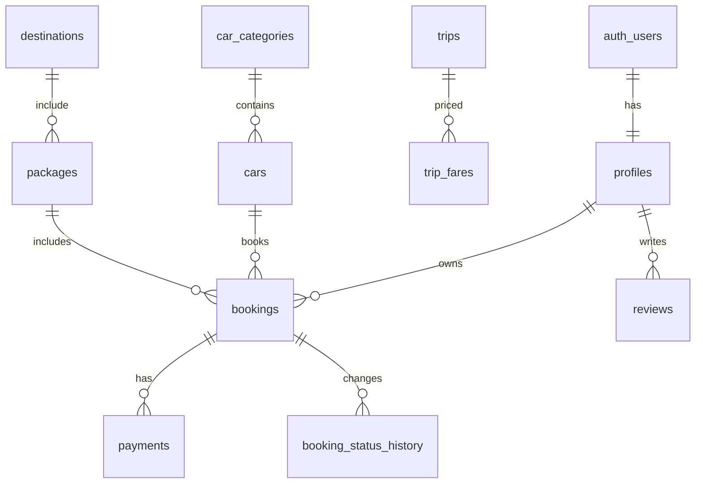

# Database schema

This milestone establishes the database foundation for TourNTravels using PostgreSQL with Supabase.

## Core design principles

- All money uses bigint paise and is non-negative.
- All timestamps are stored as `timestamptz` in UTC.
- Business timezone defaults to Asia/Kolkata and is sourced from `settings.business_timezone`.
- RLS is enabled on every table in `public` schema.
- Secret-key admin access is reserved for server-side jobs, not ordinary user reads.

## ER summary

## Enum list

- `user_role`: customer, support, admin, super_admin
- `account_status`: active, blocked
- `service_mode`: with_driver, self_drive
- `car_status`: active, inactive, maintenance
- `content_status`: draft, published, archived
- `booking_type`: trip, package
- `booking_status`: draft, pending_payment, confirmed, driver_assigned, in_progress, completed, cancelled, expired
- `payment_status`: unpaid, pending, paid, partially_refunded, refunded, failed
- `payment_record_status`: created, authorized, captured, failed
- `refund_status`: initiated, processed, failed
- `coupon_type`: flat, percent
- `review_status`: pending, approved, rejected
- `enquiry_status`: new, contacted, closed
- `email_status`: queued, sending, sent, failed
- `pricing_rule_type`: surcharge_flat, surcharge_percent, discount_percent

## RLS matrix summary

- `profiles`: self read, self limited update, staff read, admin role management
- `catalogue tables`: public read for published/active items; admin CRUD
- `bookings`: customer self read; staff broad read; admin status updates only
- `reviews`: public read only approved rows; customer CRUD on own pending review
- `settings`: staff read, admin update, public safe view for business details
- `payment tables`: customer self read; staff read; no client writes
- `audit_logs`: admin read; server-only inserts; no updates or deletes

RLS is enabled on every base table in `public`. The `public_settings` and
`public_reviews` views are not tables and therefore do not have RLS policies;
they intentionally use owner rights and expose only explicitly selected public
columns. Keep their projections allow-listed.

Storage object policies target Supabase's `storage.objects.name` column and use
`storage.foldername(name)` to enforce the owner-folder convention. Public catalogue
images are readable through their public buckets; avatar and invoice access is
restricted by the corresponding object policies.

## Double booking protection

The schema uses an exclusion constraint on `bookings` for overlapping active bookings on the same car. Draft, cancelled, expired and completed bookings do not contribute to the conflict window.

## Notes

The initial schema is intentionally a strong, secure base for later feature milestones. Booking and payment logic remains server-side and is not implemented in this milestone.
